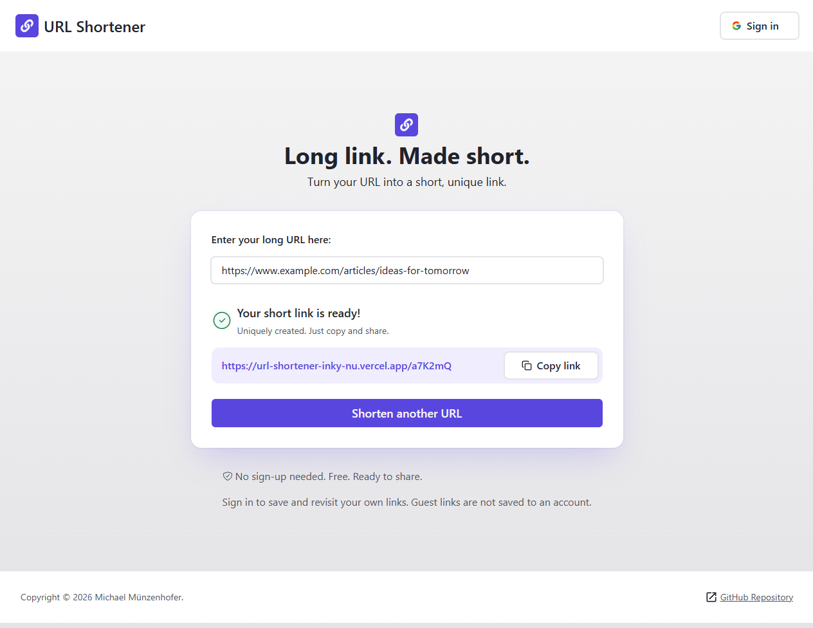

# URL Shortener

Turn long URLs into short, shareable links. Guests can shorten links right away. With a Google account, every link is saved and can be revisited under "My links".

**Live:** https://url-shortener-inky-nu.vercel.app



## Features

- Short 6-character links with a redirect to the original URL
- URL validation in the browser and on the server, including a DNS check of the domain
- Google sign-in with a personal list of saved links
- Accessible: keyboard friendly, screen reader announcements, native modal dialog

The app runs on http://localhost:3000 and needs these environment variables in `.env.local`:

```
DATABASE_URL=
NEON_AUTH_BASE_URL=
NEON_AUTH_COOKIE_SECRET=
```

The table is created with [`src/lib/db/db-schema.sql`](src/lib/db/db-schema.sql).
